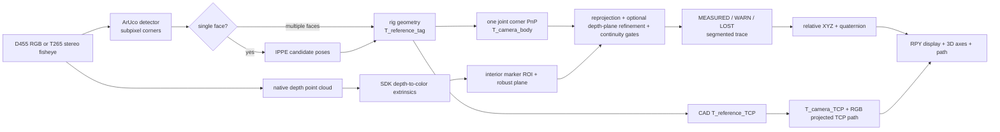

# 项目架构

项目分成定位与相机核心、应用命令、网页资源和开发工具。稳定的核心导入路径保持在 `marker6dof` 下；CLI 实现位于 `marker6dof.commands`，旧 `scripts/` 文件只调用对应的 `main()`。

| 位置 | 职责 | 修改场景 |
| --- | --- | --- |
| `src/marker6dof/*.py` | 几何、跟踪状态、RGB-D 优化、相机适配 | 算法、门控、数据模型和 SDK 接入 |
| `commands/tracking/` | 视频定位与实时面板服务 | 采集线程、启动参数和 HTTP 行为 |
| `commands/calibration/` | 多面关系、CAD 与 pivot TCP 外参 | 标定流程 |
| `commands/replay/` | 录制与面板会话重放 | 离线复现 |
| `commands/evaluation/` | 噪声、位移、静态距离与连续停顿评估 | 精度指标与验收 |
| `commands/demo/` | 合成视频与真值评估 | 无硬件闭环 |
| `commands/reporting/` | 图表、画面与报告视频 | 研究交付物 |
| `src/marker6dof/web/` | 实时面板与会话复核 HTML | 浏览器显示 |
| `tools/` | wheel 验收、标定和实验评估辅助工具 | 开发验证，不属于安装包 CLI |
| `tests/` | 几何、跟踪、评估和入口回归测试 | 算法行为变化 |

表内 `commands/` 均相对于 `src/marker6dof/`。应用调用核心模块，核心不依赖 `commands/` 或仓库里的脚本路径。五个历史安装入口通过 `cli.py` 惰性加载，新增入口直接指向包内 `main()`，返回值交给控制台启动器作为退出码。

模块边界如下：

- `localization.py` 是与相机采集无关的离线定位核心，负责标定 schema、ArUco、联合 PnP 和输出行。
- `tracking.py` 是相机无关的刚体假设、单面 IPPE 候选、时序门控和相对轨迹状态。
- `realsense.py` 是录制和实时跟踪共用的底层适配层，集中维护 ArUco 检测器、Marker 角点约定和 RealSense 投影/反投影。
- `realsense_depth.py` 将原始深度点云经真实外参转换到 RGB 坐标系，检查帧时间并适配跟踪器回调。`rgbd.py` 不依赖 SDK，用鲁棒面内深度和 RGB 角点共同优化位姿。
- `tracking.py` 在最终时序门控前调用可选的 `pose_refiner`；拒绝深度时保留 RGB，接受时重算每面重投影误差并缓存最终位姿。`depth.py` 保留旧角点融合 API 兼容性，不再用于实时融合。
- `d455.py` 是 D455 RGB-D 录制实现；`t265.py` 处理 T265 左右鱼眼、SDK 外参和双目位姿融合。
- `commands/tracking/live_dashboard.py` 只负责采集线程、HTTP 状态和页面服务；页面绘制不参与位姿估计。HTML 从包内 `web/` 读取，editable 安装保留页面更新检查。
- `commands/replay/replay_rgbd.py` 复用同一跟踪器和深度适配层，以设备时间戳回放原始 RGB-D，输出两条独立状态链及接受/拒绝诊断。完整现状与边界见 [项目梳理](project_review_rgbd.md)。

## 安装与资源边界

`pyproject.toml` 同时定义基础依赖、硬件和报告 extras、控制台入口及 HTML package-data。`requirements*.txt` 转发到这些定义。基础环境即可运行定位、RGB 离线重放与合成演示；SDK 在采集或原生 RGB-D 回放时加载，因此查看硬件命令帮助无需安装 SDK。

D455 与 T265 的 SDK 版本范围不同，各用一个虚拟环境。报告工具通过 `reporting` extra 安装 matplotlib 和 Pillow；其中 `plot_accuracy.py` 与 `render_report_rgb_panels.py` 保留历史录制场景和输出默认值，使用前应核对其数据目录。

用户配置、视频和录制不作为包资源分发。仓库里的 `configs/` 提供合成演示配置与复现标定基线；在其他工作目录运行已安装命令时，显式给出这些输入的路径。标定类型和管理方式见 [配置说明](../configs/README.md)。

`make check` 验证核心测试、合成闭环和普通 wheel 安装。wheel 检查在仓库外运行、验证导入来自临时安装环境，并借用当前环境的基础依赖；它覆盖打包边界，真实相机采集仍需连接设备验证。
