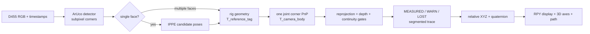

# Architecture

模块边界如下：

- `localization.py` 是与相机采集无关的离线定位核心，负责标定 schema、ArUco、联合 PnP 和输出行。
- `tracking.py` 是 D455 实时前端的刚体假设、单面 IPPE 候选、时序门控和相对轨迹状态。
- `realsense.py` 是录制和实时跟踪共用的底层适配层，集中维护 ArUco 检测器、Marker 角点约定和 D455 投影/反投影。
- `d455.py` 是唯一的 D455 录制实现；`scripts/record_d455.py` 只保留兼容启动入口，避免两份录制逻辑漂移。
- `scripts/live_dashboard.py` 只负责采集线程、HTTP 状态和页面服务；页面绘制不参与位姿估计。
