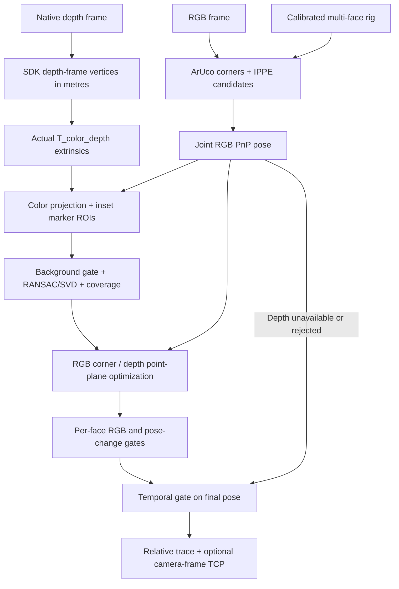

# 项目梳理与 D455 Marker 深度融合

核查日期：2026-09-24。以当前工作树为准；原有未提交的 D455、T265、CAD/TCP 改动均保留。
现有 Graphify 图谱可用于定位模块，但部分节点仍指向迁移前路径，本文结论已对照当前源码。

## 1. 项目定位与当前完成度

本项目估计 **47.5 mm 多面 ArUco 刚体在相机光学坐标系中的 6DoF 位姿**，并产生以
首次接受位姿为原点的相对轨迹。D455 是 RGB-D 后端，T265 是另一条双鱼眼后端。
TCP 需要实测外参；世界轨迹还需要相机在世界中的位姿。检测成功、低重投影误差和
轨迹平滑都不能单独证明绝对毫米精度。

| 模块 | 已有职责 | 使用边界 |
| --- | --- | --- |
| `localization.py` / `run_video.py` | 通用标定 schema、ArUco、平面 IPPE、多面 EPNP RANSAC + LM、TCP 输出 | 离线核心，输入每面在刚体系内的三维角点；与实时跟踪器不是同一质量策略 |
| `tracking.py` | 每面 IPPE 双候选、多面刚体角点联合 PnP、整面剔除、连续性消歧与分段 | 使用 `T_reference_tag` rig；SINGLE/MULTI/WARN/LOST |
| `build_relative_trajectory.py` | 共视相对外参、离群筛选、BFS 初始化、邻接边迭代一致化 | 是粗标定，不是全局角点 bundle adjustment；附带轨迹也不等于实时联合 PnP 输出 |
| `realsense.py` | 共享 Marker 角点顺序、检测器、SDK 投影与反投影 | 不把畸变模型直接当普通针孔模型 |
| `d455.py` | RGB-D 录制、原始 `.db3`、RGB 视频、单 Tag PnP 和深度诊断 | 深度中值诊断不等于融合或真值 |
| `t265.py` | 左右鱼眼各自估计、SDK 外参转换、双目一致性融合 | 没有深度；当前 Marker 轨迹没有与 pose stream 合成为世界轨迹 |
| `projection.py` | 刚性变换校验、CAD/TCP 外参、相机图像叠加 | 单位米，`T_reference_TCP` 将 TCP 点变换到参考 Marker 系 |
| `live_dashboard.py` / `.html` | 相机采集、调用跟踪器、JSON/JPEG、浏览器轨迹 | 平滑仅用于显示；相机运动时不能把历史相机系点当静止世界轨迹 |

原有深度原型 `depth.py` 是“角点 patch 中值 → 3D 刚体 Kabsch → 0.2 位姿插值”。
其默认至少 6 个角点，单面 4 角必然不能融合；角点 patch 可能跨入背景，融合后也没有
重新验证 RGB 重投影。本次保留该 API 兼容性，实时路径改用下述面内联合优化。

## 2. 本次新增和修改

| 文件 | 本次职责 |
| --- | --- |
| `src/marker6dof/rgbd.py` | 无 SDK 依赖的鲁棒平面筛选及 RGB/深度联合优化 |
| `src/marker6dof/realsense_depth.py` | 原始深度点云 → RGB 系，时间同步检查，跟踪器回调 |
| `src/marker6dof/tracking.py` | 增加可选 `pose_refiner`，最终 RGB/时序门控和缓存均使用实际输出位姿 |
| `scripts/live_dashboard.py` | `--use-depth` 接入新回调；D455 跟踪使用设备时间戳，处理帧率使用主机单调时钟 |
| `scripts/replay_rgbd.py` | 原始 RGB-D 回放，RGB 与 RGB-D 两个独立跟踪器，逐帧诊断和汇总 |
| `tests/test_rgbd.py` | 单/多面、背景、退化、独立噪声对照、参数、数值和回退测试 |
| `tests/test_realsense_depth.py` | 坐标变换、SDK 适配、时间戳、缺失深度和异常回退测试 |
| `tests/test_tracking_rgbd.py` | 融合位姿的缓存、重投影复核和最终时序门控测试 |

没有增加新的大型依赖；继续使用 NumPy、SciPy、OpenCV，以及硬件可选依赖 pyrealsense2。
没有替换已有 rig 标定或 TCP 外参，没有自动启动相机或修改原始录制。

## 3. 正确的 RGB-D 几何链路



约定 `T_A_B` 把 B 系点变换到 A 系，长度单位米：

```text
p_color = R_color_depth · p_depth + t_color_depth
p_color = T_color_reference · p_reference
T_color_TCP = T_color_reference · T_reference_TCP
T_relative(t) = inverse(T_color_reference(0)) · T_color_reference(t)
```

SDK `pointcloud.calculate(native_depth_frame)` 的 vertices 属于深度光学系，使用真实
depth-to-color 外参后才属于颜色光学系。SDK 外参旋转数组按列存储，NumPy 读取时
使用 `reshape(3, 3, order="F")`。`map_to(color_frame)` 产生的 UV 是颜色像素除以
图像宽高；本实现乘回宽高筛选 ROI，并在同一取整 RGB 像素保留最近表面。[1][2]

**不能把 `rs.align(color)` 理解为已完成所有 3D 坐标变换。** 官方实现将原始 Z16
值搬到目标像素，输出 profile 换为目标内参；有非零轴向平移/相对旋转时，这个数值
仍不能严格当作 RGB 光轴 Z 再反投影。本实现直接使用原始点云和真实外参。[1]

RGB 与深度时间戳必须来自相同 SDK 时钟域；默认允许绝对差不超过 20 ms。SDK
frameset 里可能包含重复或陈旧深度帧，不能仅凭“同一 frameset”就认为曝光同步。
20 ms 是工程门限，快速运动时应依据目标速度进一步收紧，并实测曝光同步。

## 4. 深度平面与联合目标函数

对每个已被 RGB 接受的 Marker 面：

1. 检测四边形相对中心缩小，默认每侧内缩 15%，剩余线性尺寸约 70%；不在边角取中值。
2. 剔除零值、非有限点、背面点及与 RGB 预测面/光轴深度差超过 30 mm 的点。
3. 确定性采样，每面最多 200 点；至少 20 点才尝试拟合。
4. RANSAC + SVD 拟合，检查内点率、点到面 RMS、二维凸包覆盖、三维空间展布及与 RGB 法向一致性。
5. 保留合格面上的原始深度内点，与 RGB 角点共同优化一个刚体变换。

已知刚体内第 f 面的中心 `c_f` 和单位法向 `n_f`，候选位姿 `(R,t)` 下：

```text
RGB residual:    r_uv = (project(R P_i + t) - observed_pixel_i) / sigma_uv
Depth residual:  r_d  = (R n_f)^T · (Q_fj - (R c_f + t)) / sigma_d

实际传入 soft_l1 的残差：
  RGB 各标量残差除以 sqrt(全部 RGB 标量残差数)
  每面 depth 残差乘 sqrt(depth_weight / (有效面数 × 该面支持点数))
```

按面和采样数归一化，避免某面仅因为深度点更多就支配结果。默认 `sigma_uv=1 px`、
`sigma_d=3 mm` 是可调经验尺度，不是 D455 噪声标定，也不是输出协方差。
`depth_weight=0.2` 表示归一化平方残差权重；即使设置 1，RGB 项仍存在；0 精确保留 RGB。
它与旧接口“20% 位姿插值”语义不同。

单平面只能提供法向方向和沿法向位置约束；面内平移和绕法向旋转仍需 RGB 角点。
这种互补性可参考 Jin 等人的 RGB-D fiducial 论文及 ViSP 实现。[3][4]

为兼容 SDK 内部 float32 投影，优化使用绝对步长中央差分 Jacobian：旋转 `1e-4 rad`，
平移 `1e-5 m`，避免默认极小差分步长导致数值导数为零。

| 门限 | 当前默认值 | 含义 |
| --- | --- | --- |
| 深度帧时间差 | 20 ms | 不同时间域直接拒绝 |
| 每面支持点 | 20–200 | 最小有效点数 / 最大优化采样点数 |
| RANSAC 内点距离 | 3 mm | 80 次确定性随机采样 |
| 最小内点比例 | 0.65 | 在预筛选后样本内计算 |
| 最大平面 RMS | 2.5 mm | 不能检测整面共同的系统偏差 |
| 最小凸包覆盖率 | 0.20 | 空间展布，不是像素有效填充率 |
| RGB 预测面距离差 | 30 mm | 排除明显背景，限制局部精修范围 |
| 深度/RGB 法向差 | 20° | 使用法向正负不变的夹角 |
| 最终位移 / 旋转变化 | 50 mm / 10° | 相对 RGB 初值 |
| 每面最终重投影 | ≤ 2.5 px | 由 tracker `--max-error-px` 控制 |
| tracker 每面误差增长 | ≤ 0.25 px | 独立于核心优化器的最后一道检查 |

核心优化器还检查每面误差不超过 `RGB初值 × 1.25 + 0.5 px`；实时/回放 tracker
的 `+0.25 px` 门限通常更严格。通过几何检查后，再对最终位姿执行原有时序门控；
缓存和 UI 重投影指标都对应实际输出位姿。深度诊断独立于 `SINGLE/MULTI` 状态。

### 状态与局限

- `RGB_DEPTH_REFINED`：通过局部融合检查；仍须看 tracker 最终是否接受位姿。
- `INSUFFICIENT_DEPTH`：点数、支持面或空间展布不足。
- `DEPTH_REJECTED_RGB_DISAGREEMENT`：深度几何与 RGB 不一致。
- `DEPTH_REJECTED_REPROJECTION` / `DEPTH_REJECTED_TRACKER_REPROJECTION`：候选破坏 RGB 角点约束。
- `DEPTH_TIME_MISMATCH` / `DEPTH_TIMESTAMP_DOMAIN_MISMATCH`：不同步或时钟不可比较。
- `NO_DEPTH_FRAME` / `DEPTH_SDK_ERROR`：缺帧或深度 SDK 异常，保留 RGB。

这一步是 **选定 RGB/IPPE 分支之后的局部精修**，不是深度参与全部 IPPE 候选重排。
大角度双解翻转仍可能无法纠正。IPPE 本身输出多个候选，不保证小/远目标仅凭重投影
就能无歧义选择真实解；后续可将可信平面提前用于候选评分。[5][6]

RANSAC 只能排离群点，不能消除深度的共同偏差。例如整面深度偏移数毫米，拟合残差
仍可能很小，且远距离 RGB 对这种变化不敏感。因此不能靠加大权重或放宽门限来证明
精度；应先标定距离相关噪声和偏差，再用独立参考验收。

## 5. 本轮验证及数据结论

### 基线与离线合成闭环

开始时现有 18 项测试通过。新增测试覆盖核心、SDK 适配和 tracker 集成，最终全仓
**94 项测试及 18 个参数子用例通过**，并通过语法编译和 `git diff --check`。
原有 60 帧合成视频闭环再次通过：位置误差 p95 `6.983 mm`，
旋转误差 p95 `3.175°`。输出在 `outputs/rgbd_review_demo_20260924/result/evaluation.json`。
这是原 RGB/标定/TCP 管线回归，不是深度融合精度结论。

新增独立噪声对照位于 `test_independent_depth_improves_noisy_corner_pnp_in_synthetic_trials`：
48 mm Marker、0.85 m、0.35 px 角点噪声，先 IPPE + 纯 RGB LM，再叠加独立的
1 mm 轴向深度噪声并融合。20 个固定随机种子（包含回退结果）中 14 次接受，
平均平移误差 `7.117 → 2.442 mm`，平均旋转误差 `10.022 → 9.085°`。
该结果仅适用于测试指定的合成噪声模型，**不是 D455 实测精度**。

### 现有真实数据

旧 RGB MP4 重放 `outputs/replay_47_5mm/summary.json` 有 834 帧，833 帧检测到
目标，重投影中位约 0.200 px；其历史录制尺寸 48 mm 已按 47.5 mm 重放。
原始单 Marker 深度中值诊断与 PnP Z 差中位约 +1.137 m，提示深度不可信，但不能
只凭此数值将原因全部归结为黑色油墨。

本次原始 RGB-D 对照回放使用：

```text
输入：outputs/captures/20260922_183013/raw_realsense.db3
结果：outputs/rgbd_full_20260924/summary.json
逐帧：outputs/rgbd_full_20260924/frames.jsonl
原录制审计：outputs/rgbd_full_20260924/recording_audit.json
```

| 指标 | 结果 |
| --- | --- |
| 原始颜色帧数 | 877，完整回放到 EOF |
| RGB / RGB-D 输出有效位姿 | 各 877 帧 |
| 单面 / 多面 | 745 / 132 帧 |
| 真正接受深度精修 | 0 帧 |
| 时间不一致而回退 | 43 帧 |
| 几何不一致而回退 | 834 帧 |
| RGB / 最终输出重投影中位 | 均约 0.1833 px |
| RGB-D 跟踪耗时中位 / p95 | 约 68.95 / 89.37 ms |

877 是原生录制颜色流帧数，834 是旧 MP4 导出的帧数，两种输入不同，不应混用
覆盖率或把差异说成算法提升。只读核对原始数据库的所有颜色时间戳与回放完全一致。
对每个颜色帧在全部原始深度时间戳里找最近邻，仍有同样 43 帧超过 20 ms；
不是回放器故意错配。录制含 `Depth stream start failure`，初期有约 1.37 s 深度断流。

结论：本次真实回放验证了输入几何、完整记录和保守回退；**没有验证深度带来的真实
精度提升**。默认 `--use-depth` 仍需显式开启。当前全分辨率 SDK 点云加 Python ROI
筛选有明显开销，上述测量未达到 30 Hz；不能将配置的 30 fps 输入当作 30 Hz 融合输出。
后续可评估深度降采样、ROI 投影和向量化优化，但需同时验证小 Marker 的有效支持点数。

## 6. 使用方法

在源码目录中使用 editable 安装：

```bash
.venv/bin/python -m pip install -e '.[dev,d455]'
PYTEST_DISABLE_PLUGIN_AUTOLOAD=1 .venv/bin/python -m pytest -q

.venv/bin/python scripts/live_dashboard.py \
  --camera d455 --rig configs/rig_calibration_id2.json \
  --marker-size-mm 47.5 --use-depth --depth-weight 0.2
```

可选 `--serial` 指定设备，`--tcp-transform` 加入实测 CAD/TCP 外参。浏览器状态包含
`depth_report.planes`、深度拒绝原因、`rgb_reprojection_error_px` 和最终
`reprojection_error_px`。端口默认 8765。

原始回放无需接相机：

```bash
.venv/bin/python scripts/replay_rgbd.py \
  --recording outputs/captures/20260922_183013/raw_realsense.db3 \
  --rig configs/rig_calibration_id2.json \
  --marker-size-mm 47.5 \
  --output-dir outputs/rgbd_replay_new
```

首次可加 `--max-frames 100`，summary 明确标成截断回放。脚本拒绝覆盖已有结果，
保留无 Marker 帧，并将数据问题写入逐帧诊断。`replay_d455.py` 仍用于仅 RGB MP4
的轻量重放，不能用它验证深度融合。

## 7. 后续优先级

1. **重新获取有效深度与独立真值。** 先检查深度流启动、深度覆盖、打印平整度、
   曝光、距离和视角；保留原生 RGB-D。用已知位移/姿态平台、机器人或独立测量系统
   比较 RGB-only 与 RGB-D 的位置/角度误差、静止抖动、翻转率、失锁率和耗时。
2. **深度参与 IPPE 候选选解。** 为合格深度平面设计不确定度权重，用于候选重排，
   再局部精修；当前门控无法普遍纠正大分支翻转。
3. **标定和链路统一。** 粗 rig 图升级为带角点观测权重的全局优化；
   `build_relative_trajectory.py` 附带轨迹目前挑选单 Tag，并非实时联合求解。
   两种 calibration schema、TCP loader 和时间语义需要统一；缺帧要显式保留。
4. **性能及部署。** 继续定位全分辨率点云开销。命令实现与 HTML 已归入 Python 包；
   `make package-check` 验证普通 wheel 的入口、资源和合成闭环，部署流程见
   [迁移说明](migration.md)。
5. **额外相机功能。** T265 的仅右眼录制转换分支仍需统一到左眼系；将 pose stream
   接入世界轨迹时需严格定义外参和时钟，不能直接混用 Marker 位姿与 T265 世界位姿。

## 8. 原始资料与开源参考

以下资料用于核对方法和几何。本次 Python 联合优化为项目内实现，没有复制 ViSP C++ 源码，
也未引入新的检测器。论文/项目中的性能数据不能直接移植到 D455 和当前 Marker 尺寸。

1. [RealSense align.cpp](https://github.com/realsenseai/librealsense/blob/master/src/proc/align.cpp)：
   深度对齐的像素/数值语义，重点 `align_z_to_other` 和 aligned profile。
2. [RealSense pointcloud.cpp](https://github.com/realsenseai/librealsense/blob/master/src/proc/pointcloud.cpp)：
   原始深度反投影、外参转换与颜色 UV；也可参考官方
   [Python pointcloud viewer](https://github.com/realsenseai/librealsense/blob/master/wrappers/python/examples/opencv_pointcloud_viewer.py)。
3. [Jin, Matikainen, Srinivasa, IROS 2017: Sensor Fusion for Fiducial Tags](https://personalrobotics.cs.washington.edu/publications/jin2017rgbdtags.pdf)：
   深度平面、初始姿态、约束 RGB 优化；原传感器为 Kinect V2，噪声模型需重标定。
4. [ViSP vpPoseRGBD.cpp](https://github.com/lagadic/visp/blob/master/modules/vision/src/pose-estimation/vpPoseRGBD.cpp)：
   面内深度、鲁棒平面与多面 RGB-D 位姿参考，文件头为 GPL v2-or-later。
5. [IPPE 原作者实现](https://github.com/tobycollins/IPPE)：平面双解、近仿射视角歧义及 OpenCV 集成。
6. [OpenCV solvePnP 文档](https://docs.opencv.org/4.x/d5/d1f/calib3d_solvePnP.html)：
   `IPPE_SQUARE` 点序、多个候选及 PnP 精修接口。
7. [AprilTag 3 官方项目](https://github.com/AprilRobotics/apriltag)：后续可做检测器对照，
   但仅换检测器不能解决平面几何歧义，不是当前深度接入的前置条件。
