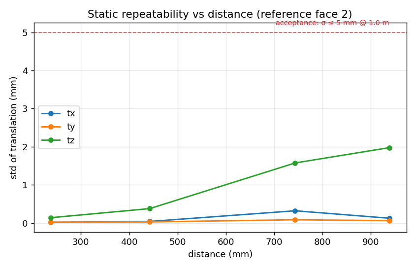
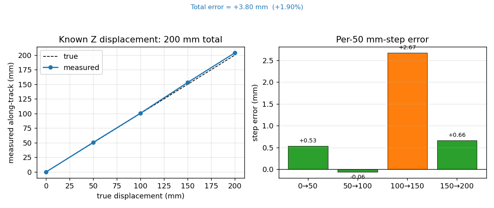

# 精度测试 SOP（D455 / Marker 6DoF）

**结论分级：**静态标准差说明重复性；已知位移和卷尺说明相对位移/距离误差；独立真值与估计位姿完成时间、坐标和目标对齐后，才能报告绝对位姿精度。

| 级别 | 本次可得结论 | 主要产物 |
| --- | --- | --- |
| A 静态 | 单面位置重复性 | `static_noise.json` |
| B 位移 | 已知位移的误差，不是绝对位置误差 | `known_displacement.json` |
| C 距离 | 卷尺原始误差与基线修正后的相对距离误差 | `tape_static.json` |
| D 外部真值 | 完成配对后的位置/姿态误差；当前自动适配器**未实现** | `ground_truth/` 真值数据与清单 |

## 部署（D455 本机）

在连接 D455 的设备上使用 Python 3.10+；在项目 checkout 根目录创建环境并安装：

```bash
python3 -m venv .venv
source .venv/bin/activate
python -m pip install -e ".[d455]"
```

## 执行前固定条件

执行者：测试工程师；测试负责人在采集前填写各项验收阈值。记录 `TEST_ID`、分支/提交、D455 序列号、内参来源、Marker 字典/ID/黑框外边长、rig/TCP 来源、曝光、分辨率、帧率和坐标约定。保持相机和 Marker 安装不变。以下 A–C 工具读取录制会话中的**单面** `poses.csv`，不能直接得出多面 rig 或 TCP 的精度。

## 1. 采集统一入口

```bash
marker-record-d455 --serial <SERIAL> --ids <IDS> \
  --marker-size-mm <SIZE_MM> --duration 0 \
  --output-root captures/accuracy/<TEST_ID>/<SCENE>
```

每个静态点停稳 5–10 秒，按 Q 结束。检查会话 `metadata.json`、`poses.csv`、`frames.csv`、`summary.json`；原始 RGB-D 需保留默认录制，不加 `--no-raw`。静态段移动、有效检测不足或条件改变时重录并记录原因。

## 2. A：静态重复性

相机和 Marker 固定，建议在 0.3 m 与 1.0 m 各录 2–3 段。把全部会话目录作为位置参数传入：

```bash
marker-eval-static-noise \
  captures/accuracy/<TEST_ID>/static_0p3m/<TIMESTAMP> \
  captures/accuracy/<TEST_ID>/static_1p0m/<TIMESTAMP> \
  --output outputs/accuracy_test/<TEST_ID>/static_noise.json
```

**记录：**每个 `tag_id` 的 `std_mm`、有效帧数和重投影 P50/P95。不要把不同 Marker 面的 `pooled_std_mm` 当成单面噪声。



历史实验示例，仅展示静态重复性的读图方式。图中的 1.0 m / 5 mm 线是原实验设定，不自动成为新测试的验收阈值。图片见 [静态重复性示例](assets/sop/static_repeatability_distance.png)。

## 3. B：已知位移

用导轨或机器人做单轴平移；A、B 两端分别静止录制。真值向量单位为米，遵循相机光学系（X 右、Y 下、Z 前）。以下为向相机移动 200 mm 的示例，须替换成实测值：

```bash
marker-eval-displacement \
  --seg1 captures/accuracy/<TEST_ID>/displacement/A/<TIMESTAMP> \
  --seg2 captures/accuracy/<TEST_ID>/displacement/B/<TIMESTAMP> \
  --true-dz -0.200 \
  --output outputs/accuracy_test/<TEST_ID>/known_displacement.json
```

**记录：**`absolute_error_mm`、`per_axis_error_mm`、`inter_face_spread_mm` 和 `warnings`。`absolute_error_mm` 是**位移向量误差的模**；手持产生未测横向位移时，不能宣称纯 Z 轴精度。



历史卷尺步进示例：沿拟合轨迹累计 200 mm 的图示误差为 +3.80 mm；它不是独立绝对位姿真值，也不是本 SOP 的受控单轴验收结果。图片见 [已知 Z 位移示例](assets/sop/known_z_displacement_200mm.png)。

## 4. C：卷尺多距离

相机固定，Marker 尽量平行光轴；按卷尺参考点在 20/40/60/80 cm 各录一段。距离须实测，以下数字仅示例：

```bash
marker-eval-tape-static \
  --point 20=20=captures/accuracy/<TEST_ID>/tape_20cm/<TIMESTAMP> \
  --point 40=40=captures/accuracy/<TEST_ID>/tape_40cm/<TIMESTAMP> \
  --point 60=60=captures/accuracy/<TEST_ID>/tape_60cm/<TIMESTAMP> \
  --point 80=80=captures/accuracy/<TEST_ID>/tape_80cm/<TIMESTAMP> \
  --tag-id <TAG_ID> --metric z \
  --output outputs/accuracy_test/<TEST_ID>/tape_static.json
```

**记录：**各点 `raw_error_mm` 与 `baseline_corrected_error_mm`。前者含卷尺参考面到 RGB 光心的偏移；后者仅评价相对距离变化，不代表绝对相机坐标精度。

## 5. D：外部真值入口（结合项目实际）

**D 级目标：**用机器人、动捕或激光跟踪仪提供独立的 3D 位置/姿态，再与 D455 的 `poses.csv` 按时间、坐标系和目标点配对。只有配对规则、外参和阈值在采集前固定，才能报告绝对精度。

### 当前项目已有证据

| 数据 | 实际内容 | 可报告 | 不能报告 |
| --- | --- | --- | --- |
| 静态激光基准 | 36 个点、20–150 cm、4 种 Marker 配置；真值点为 Marker 4 中心沿外法线 25.5 mm 的测量点 | 点间距离 RMSE；候选内参相对基线改善约 4–11% | 单帧绝对 XYZ、姿态、动态精度 |
| 动态激光对照 | 3 段轨迹，激光约 10 Hz；保存的 RGB 角点重算联合 PnP，再做事后时移和刚体对齐 | 本批轨迹位置 RMSE 19.49–28.98 mm；1 秒位移长度 RMSE 10.15–14.13 mm | 独立世界坐标验收、生产 RGB-D 输出精度、外推到其他速度/设备 |

静态激光结果见[标定与激光真值报告](marker_intrinsics_comparison_20261020.md)，动态结果及验收边界见[验证结果与验收边界](project_closure_validation.md)。动态原始数据和评估脚本目前未纳入 GitLab 仓库。当前结论是：**已有独立激光相对真值，D 级绝对 XYZ/姿态自动配对尚未接入。**

### 新测试的真值交接

1. 固定被测点：真值测量的实体必须和 `tag_id` 对齐。项目历史激光使用 Marker 4 外法线 25.5 mm 处的实际测量中心；若真值测的是 TCP、靶球或 Marker 中心，必须提供实测目标外参。
2. 固定坐标和时间：记录真值坐标系、单位、时区/时钟源、相机与真值的时间偏移；未知的时移、配对窗口和阈值留空，不能事后猜填。
3. 保留同一测试的两路原始数据：

   ```text
   outputs/accuracy_test/<TEST_ID>/ground_truth/
   ├── ground_truth_manifest.yaml
   ├── ground_truth.csv
   ├── transform_to_camera.json      # 真值系不是 camera 时提供
   └── target_alignment.json         # 真值目标不是 tag 时提供
   ```

4. 复制 [真值清单模板](../configs/ground_truth_manifest.template.yaml)，至少填写 `provider`、`truth_file`、`truth_frame`、`truth_target`、`estimate_file`、`estimate_tag_id`、时间戳字段和外参。D455 估计文件使用 `poses.csv` 的 `host_timestamp_s`、`tag_id`、`tx_m/ty_m/tz_m`；单位统一为米。

最小真值 CSV：

```csv
timestamp_ns,tx_m,ty_m,tz_m,status
```

### 项目历史激光字段对照

复用项目已有动态激光数据时，真值 CSV 的实际字段是 `host_epoch_s`（秒）、`x_m/y_m/z_m`（米），没有姿态四元数；新录制的 D455 `poses.csv` 对应 `host_timestamp_s`、`tx_m/ty_m/tz_m`。以下是历史激光数据的字段映射，其他必填项仍按实测填写：

```yaml
provider: laser_tracker
truth_file: ground_truth.csv
truth_frame: laser_world
truth_target: marker4_center_offset_25p5mm
truth_timestamp_column: host_epoch_s
truth_timestamp_unit: s
truth_position_columns: [x_m, y_m, z_m]
truth_orientation_columns: null
estimate_timestamp_column: host_timestamp_s
estimate_timestamp_unit: s
```

这份历史数据可用于复核动态相对轨迹；若要升级为绝对 XYZ/姿态验收，仍需补齐相机—激光坐标变换、目标外参、固定时间偏移和独立重复测试。

需要姿态真值时增加 `qx,qy,qz,qw`。配对后至少输出位置 XYZ 的 MAE/RMSE/P95、有效配对数/覆盖率和时间延迟；有姿态真值时再输出姿态角误差。不得用同一批数据同时拟合外参/时移又宣称独立绝对精度。当前仓库没有读取清单并自动配对的命令，完成配对前 D 级结果填写“待接入”。

## 6. 报告与判定

每份报告附 `TEST_ID`、提交号、会话路径、有效帧数、覆盖率、静态告警、真值来源/有效配对数和预先设定的阈值。A–C 分别判定，不因 D 级未接入而抹去已有相对结果；只有 D 级完成时间、坐标、目标配对并达到阈值，才写“绝对精度通过”。异常保留原始数据、命令和日志，不改写原始 CSV。
