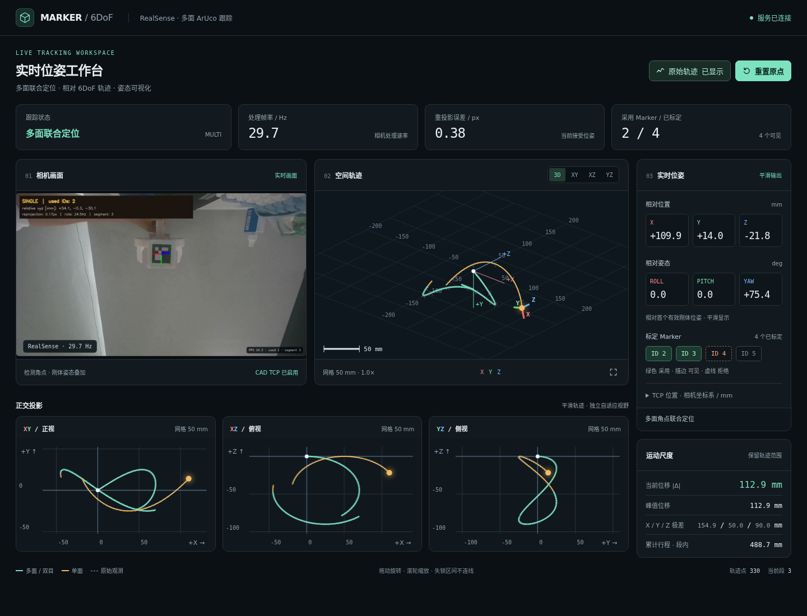

# 算法跑通 SOP（D455 / Marker 6DoF）

**完成结论：**合成演示通过、D455 会话可回放、多面 Marker 相对轨迹可生成，才可写“算法链路跑通”。这不等于 TCP 或绝对位姿精度通过。

| 关口 | 产物 | 通过判定 |
| --- | --- | --- |
| 软件闭环 | `outputs/sop_demo/result/evaluation.json` | `passed=true`，所有帧均为 `MEASURED` |
| 实机采集 | 会话目录 `metadata.json`、`frames.csv`、`poses.csv`、`color_raw.mp4` | 有效帧与目标检测非零；保留原始录制 |
| 多面关系 | `relative_trajectory.csv/.json`、`rig_calibration.json` | `relative_trajectory_ready=true`；检查告警与可达 ID |
| 离线回放 | `replay/summary.json`、`replay_poses.csv` | 覆盖率达到预设运行门槛；检查重投影误差与失锁 |

## 部署（D455 本机）

在连接 D455 的设备上使用 Python 3.10+；在项目 checkout 根目录创建环境并安装：

```bash
python3 -m venv .venv
source .venv/bin/activate
python -m pip install -e ".[dev,d455]"
```

## 执行前

执行者：算法或测试工程师。记录日期、分支/提交、D455 序列号、Marker 字典和 ID、黑框**实测外边长**、分辨率/帧率、内参来源。使用本仓库根目录；命令中的 `<...>` 均替换为本次值。多面标定需要面间重叠视角。无实测 TCP 外参时，只验收相对轨迹。

## 1. 检查环境与软件闭环

```bash
source .venv/bin/activate
PYTEST_DISABLE_PLUGIN_AUTOLOAD=1 python -m pytest -q
make demo DEMO_DIR=outputs/sop_demo
```

检查测试退出码及 `evaluation.json` 的 `passed`。演示默认门槛为最大位置误差 15 mm、最大旋转误差 8°；它只验证合成数据链路。任一失败，记录命令与日志，停止标记“跑通”。

## 2. 录制一段 D455 会话

```bash
marker-record-d455 --serial <SERIAL> --ids <IDS> \
  --marker-size-mm <SIZE_MM> --duration 30 \
  --output-root captures/d455_aruco/sop_run
```

缓慢转动 Marker 刚体，使相邻面同时可见。会话写在 `captures/d455_aruco/sop_run/<TIMESTAMP>/`。检查 `summary.json`、视频、帧表和位姿表；后续 RGB-D 复验还需保留默认生成的 `raw_realsense.db3`。若检测为零或缺文件，检查尺寸、ID、曝光和视角后重录。

## 3. 生成多面相对轨迹

```bash
marker-build-relative \
  --poses captures/d455_aruco/sop_run/<TIMESTAMP>/poses.csv \
  --output outputs/sop_run/relative_trajectory.csv \
  --reference-id <REFERENCE_ID> --min-overlap 60 \
  --marker-size-mm <SIZE_MM> \
  --rig-output outputs/sop_run/rig_calibration.json
```

检查 `relative_trajectory.json` 的 `relative_trajectory_ready`、`reachable_ids` 和 `consistency_warning_frames`。重叠不足或参考面不可达时补录，不手改 CSV。无实测 TCP 文件时 `metric_tcp_ready=false` 是正常结果。

## 4. 离线回放

```bash
marker-replay-d455 \
  --session captures/d455_aruco/sop_run/<TIMESTAMP> \
  --output-dir outputs/sop_run/replay --min-coverage 0.5
```

检查 `summary.json` 的 `frame_coverage`、重投影误差 P50/P95 和 `replay_poses.csv`。这里的 0.5 只是示例运行门槛；项目验收值须事先确定。该命令复验**单面检测**，不代表多面融合精度。

## 可选：复验 RGB-D 多面分支

仅在保存了原始 DB3、且 rig 已通过第 3 步时执行：

```bash
marker-replay-rgbd \
  --recording captures/d455_aruco/sop_run/<TIMESTAMP>/raw_realsense.db3 \
  --rig outputs/sop_run/rig_calibration.json \
  --marker-size-mm <SIZE_MM> --output-dir outputs/sop_run/rgbd_replay
```

检查 `frames.jsonl`、`summary.json` 的 RGB/RGB-D 接受与拒绝数及原因。重投影误差和融合接受率都不是独立真值。交付时保留命令、代码提交、配置、会话路径和以上产物；实机步骤未经执行时填写“待实机验证”。

## 项目界面示例



这是项目已有的实时跟踪界面截图，用于识别采集画面和轨迹显示区域；截图本身不证明本次 SOP 已执行，也不代表精度验收。图片见 [SOP 截图](assets/sop/d455_live_dashboard.png)，页面服务实现在 `src/marker6dof/commands/tracking/live_dashboard.py`。
